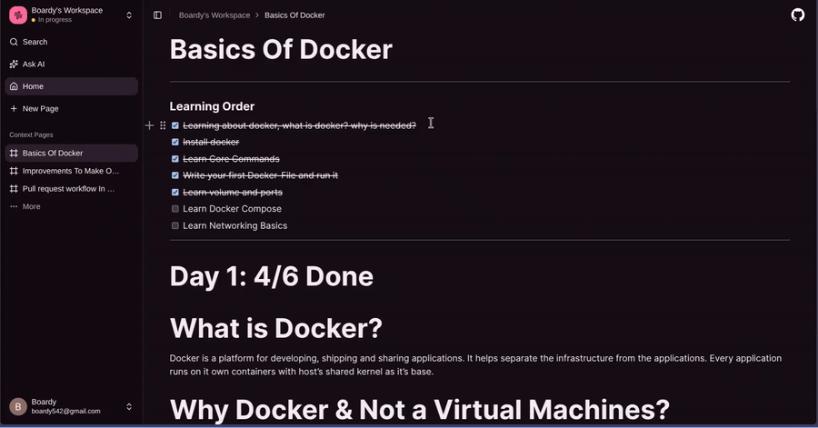

# Help Me Journal

An open-source, Notion-style notes and journaling app. Pages are written in a block editor, organized in workspaces, and (eventually) searchable and answerable through an AI assistant using RAG.



**Live app:** https://vyombudha.github.io/help-me-journal/

> Work in progress. The editor, workspaces and sidebar work today. "Ask AI" (RAG over your own pages) is planned.

## Repo layout

This is a bun-workspaces monorepo.

```
help-me-journal/
├── apps/
│   ├── web/   # Frontend: React + Vite + Tailwind + shadcn/ui + BlockNote
│   └── api/   # Backend: Hono on Cloudflare Workers + Drizzle + D1
├── package.json
└── bun.lock
```

## Tech stack

**Frontend (`apps/web`)**

- React, Vite, TypeScript
- Tailwind CSS and shadcn/ui
- BlockNote (block editor)
- HashRouter (works on GitHub Pages without rewrite rules)
- Clerk for authentication

**Backend (`apps/api`)**

- Hono on Cloudflare Workers
- Drizzle ORM with Cloudflare D1
- Vitest for integration tests

## Getting started

You need [bun](https://bun.sh) installed.

```bash
git clone https://github.com/Vyombudha/help-me-journal.git
cd help-me-journal
bun install
```

### Environment variables

**Web:** copy the example file and fill in your values.

```bash
cp apps/web/.env.example apps/web/.env
```

This includes the API URL (`VITE_API_URL`) and your Clerk publishable key (`VITE_CLERK_PUBLISHABLE_KEY`).

**API:** local secrets live in `apps/api/.dev.vars` (not committed). Add your Clerk keys and any other secrets the Worker needs.

### Run locally

In two terminals:

```bash
cd apps/api
bun run db:local # migrate the d1 drizzle schema to local
bun run dev
```

```bash
cd apps/web && bun run dev
```

### Tests

```bash
cd apps/api && bun run test
```

## Deployment

- **Web:** pushes to `main` that touch `apps/web/**` deploy to GitHub Pages through GitHub Actions. Set the `VITE_API_URL` and `VITE_CLERK_PUBLISHABLE_KEY` repository variables, and set Pages source to "GitHub Actions".
- **API:** deployed manually with Wrangler.

  ```bash
  cd apps/api
  bunx wrangler deploy
  ```

## Roadmap

- [ ] Page and workspace icons (emoji, Lucide icons, image links)
- [ ] Editor customization beyond the BlockNote defaults
- [ ] Ask AI: RAG over your pages

## License

[MIT](./LICENSE)
